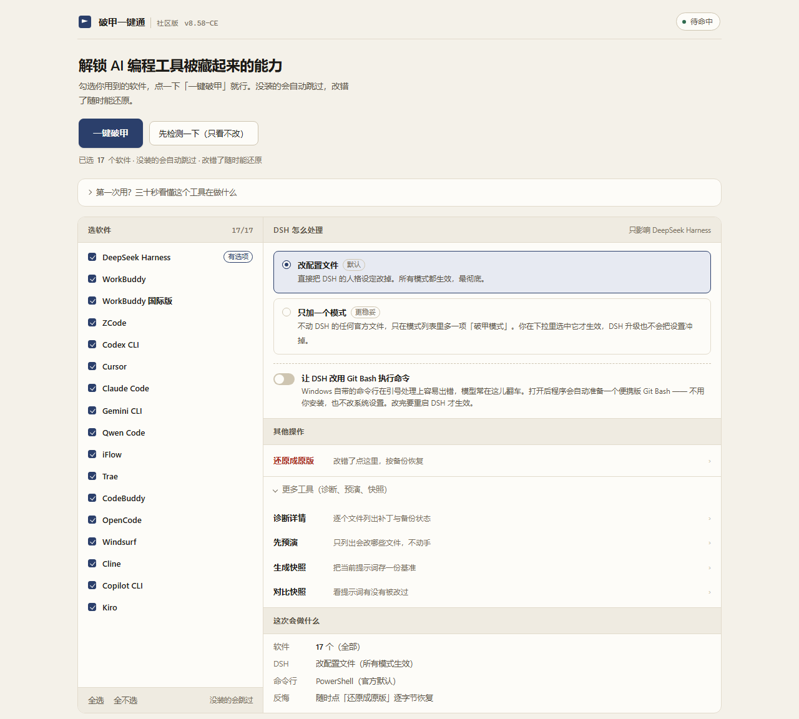
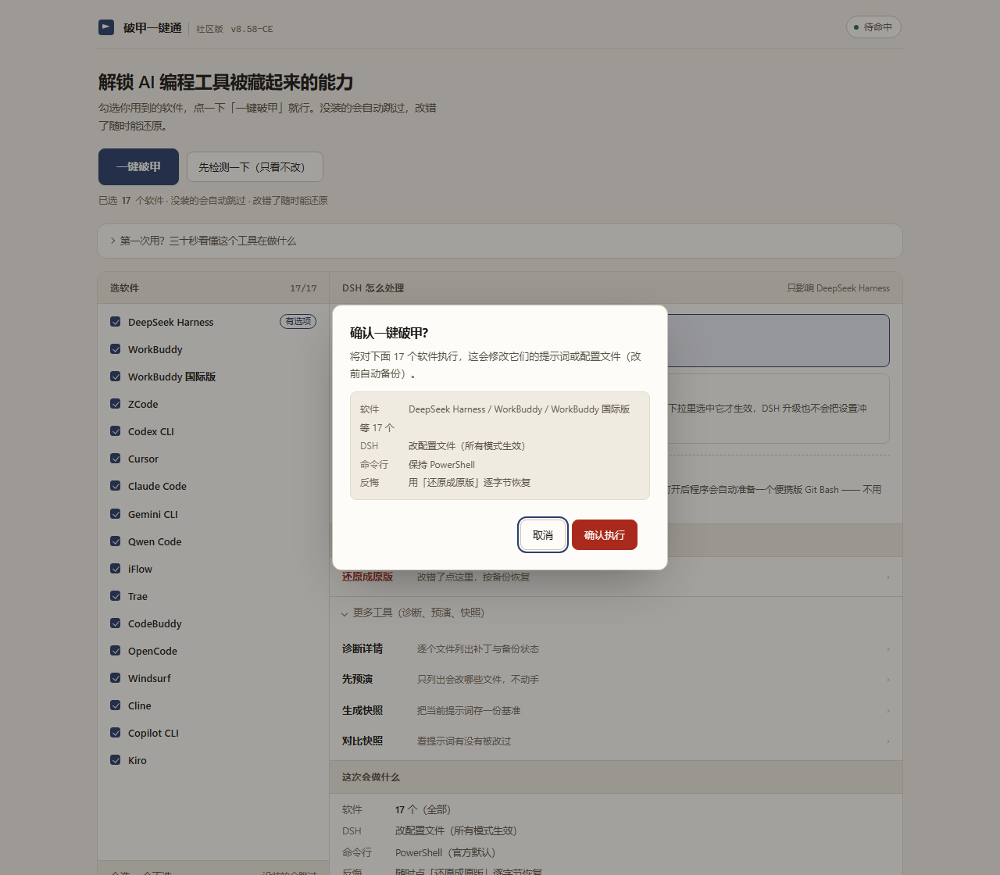

# 破甲一键通 · 社区版

> 仓库 `Mladery/pojia-modifier`，对外版本号 **`v1.0-mod`**。
> 参考了 `z91772524-ai` 的早期开源实现（`536ece2`，v8.14），在此基础上大幅调整、独立实现；MIT，**非官方**。
> 仅限在**自己有权管理的本机设备**上使用，下载前请读 [完整免责声明](docs/disclaimer.md)。

[](https://github.com/Mladery/pojia-modifier/actions/workflows/ci.yml)
[](https://github.com/Mladery/pojia-modifier/actions/workflows/build.yml)
[](LICENSE)
[](https://www.python.org/downloads/)
[](https://github.com/Mladery/pojia-modifier/stargazers)

**一句话：把你电脑上 17 个 AI 客户端「自己改不到的内置提示词」，换成你自己写的那份。**

| 换完之后 | 说明 |
|---|---|
| 用**你的**身份设定 | 而不是软件自带的默认人格 |
| **17 个客户端一份口径** | 共用 `persona.md` 或人格库，不用各改各的 |
| **当场能自证** | 发一句固定口令验证真载入，不靠「感觉好像生效了」 |
| **随时能还原** | `--revert` 回官方原版，改前备份一直都在 |

> 它**不修改软件本体**：只做文本文件层面的替换，不删包、不碰注册表 / 服务；破甲流程本身不发任何网络请求（联网只发生在你主动用 `--install-git` / `--update` 拉东西，或启动时那一次可以关掉的版本检查）。

**用着顺手就给个 Star** —— 没有推广预算，涨星全靠路过的人随手点一下。发现 bug 请开 issue，比在群里问更容易被记住。

## 使用边界（必读）

> 以下是摘要。**为了不让 README 过于冗长，初次下载的用户请务必读一遍 [完整免责声明](docs/disclaimer.md)** —— 11 条，含许可边界、滥用后果与权利人通知渠道。

- **只动你自己的机器。** 读写限于本机安装目录与用户目录，不碰他人网站 / 服务器 / 账号，不修改任何服务端，不伪造请求。
- **不是破解工具。** 不生成注册码、不伪造许可证、不绕过付费墙。这里移除的是参考版给这份 MIT 代码事后追加的封条，属于 MIT 本就授予的 `modify` 权限，不是绕过任何商业授权。
- **可逆、可审计。** 改前写旁路备份，`--revert` 一键还原；源码全公开，发布的 exe 由本仓库 Actions 从同一份源码构建。
- **无后门、无遥测。** 无账号、无登录、无统计、无云控、**无静默更新** —— 从不自动下载、自动替换、自动重启。升级只有一条路：你按下「安装」（界面上的按钮 / 菜单里的 `u` / `--update`）。核心流程（定位 → 备份 → 替换 → 校验 → 还原）全程离线。
- **联网只做三件事，都只下载、都可关。** ① `--install-git` 拉 Git for Windows 安装包；② 启动 / 打开界面时查一次「有没有新版」——只读 GitHub 公开的 `releases/latest`，不带任何本机信息、不发 query，结果缓存一天，查到了也只是一个提示加一个安装按钮；③ 你按了安装之后下载发布包。不想让它查：界面上点「以后再说」，命令行加 `--no-update-check`，或设 `POJIA_NO_UPDATE_CHECK=1`。
- **后果自负。** 按现状（AS IS）提供，无任何担保。目标客户端可能异常、更新失效、配置损坏或账号受限 —— 这些风险由使用者承担。
- **严禁违法用途。** 不得用于未授权侵入、数据窃取、制作传播恶意程序，或生成法律明令禁止的内容。工具解除的是客户端的内容限制，不免除任何法律责任。

## 界面



<details>
<summary>点「一键破甲」会先弹确认框（截图）</summary>



</details>

就是本机网页 UI：脚本起一个只绑 `127.0.0.1` 的页面，带随机 token，关掉窗口即退出。截图取自 1.0-mod 实机（Windows，17 个目标全勾选），只裁掉了页面下方的空白，内容未做任何修饰。

## 支持的目标

| 目标 | 说明 |
|---|---|
| `dsh` | DeepSeek Harness（Desktop / npm 全局 / npx 缓存 / 便携版） |
| `wb` | WorkBuddy 国内版（六层靶点 + 账号级云记忆） |
| `wbintl` | WorkBuddy 国际版（`WorkBuddyAI.exe`）—— **本仓库新增** |
| `zcode` | ZCode（`AGENTS.md` / Memory / 技能 / 可选 cjs 系统提示词） |
| `codex` | OpenAI Codex CLI（`config.toml` 的 `model_instructions_file`） |
| `cursor` | Cursor（`.cursor/rules/*.mdc`） |
| `claude` | Claude Code（`CLAUDE.md`） |
| `antigravity` | Antigravity（CLI `agy` / IDE / 桌面端，共用 `~/.gemini`；`gemini` / `agy` 仍是别名） |
| `qwen` | Qwen Code（`~/.qwen/QWEN.md`） |
| `iflow` | iFlow CLI 心流（`~/.iflow/IFLOW.md`） |
| `trae` | Trae（`~/.trae` / `~/.trae-cn`，均读 `rules/project_rules.md`） |
| `codebuddy` | CodeBuddy 腾讯（`~/.codebuddy/CODEBUDDY.md`） |
| `opencode` | OpenCode（`~/.config/opencode/AGENTS.md`） |
| `windsurf` | Windsurf（`~/.codeium/windsurf/memories/global_rules.md`） |
| `cline` | Cline（`~/Documents/Cline/Rules/pojia-inject.md`） |
| `copilot` | GitHub Copilot CLI（`~/.copilot/copilot-instructions.md`） |
| `kiro` | Kiro（`~/.kiro/steering/pojia-inject.md`）—— **本仓库新增** |

## 快速开始

### 三步

1. **写人格** —— `persona.md` 放在脚本旁边；或把片段丢进 `人格库/`，用 `--persona-set "作业,输出"` 组合。
2. **先预演** —— `--dry-run --apply`，只报要改哪些文件，一个字节都不写。
3. **再执行** —— `--apply`，改前自动旁路备份；之后 `--status` 看状态，`--revert` 还原。

### 常用命令

```bash
python src/pojia.py                      # 交互菜单
python src/pojia.py --status             # 只读：所有目标查一遍
python src/pojia.py --check              # 只读体检：含会话快照的密钥体检（脱敏）
python src/pojia.py --diagnose           # 只读：详细取证
python src/pojia.py --dry-run --apply    # 预演，不改盘
python src/pojia.py --apply --target wb  # 真打，只处理 WorkBuddy
python src/pojia.py --revert --target wb # 还原
python src/pojia.py --apply --target dsh --dsh-mode preset   # DSH：不改官方文件
python src/pojia.py --clean-spill        # 清过期的会话快照（含明文 Key）
python src/pojia.py --check-update       # 只查有没有新版（只读，不下不装）
python src/pojia.py --update             # 有新版就下、校验、替换
python src/pojia.py --no-update-check    # 这次启动别查更新
python src/pojia_gui.py                         # 图形界面（本机网页）
```

所有原始开关（`--apply` / `--revert` / `--persona` / `--guard` / `--snapshot` / `--pick`）都保留。**先 `--dry-run`，再动手。**

### 自证

在客户端**新会话**里单独发一句 `破甲自检`，只回这一行就说明人格真载入了：

```
破甲自检成功 | 社区版v1.0 | 仓库地址：https://github.com/Mladery/pojia-modifier
```

回复带解释、加戏或拒答 → 人格没生效，先确认目标已**重启**（改的是磁盘文件，运行中的进程不会重读）。

### macOS

`.app` 是整体签名的，往里写文件会让签名失效 —— 带隔离标记的包再启动会报「已损坏」。改完包内文件会**自动 ad-hoc 重签**，重签后首次打开要右键 → 打开。已经卡住的：

```bash
pojia-modifier --mac-check            # 看哪些包的签名坏了（只读）
pojia-modifier --mac-check --resign   # 顺手签回去
```

手动救援：`codesign --force --deep --sign - /Applications/Xxx.app` 或 `xattr -cr /Applications/Xxx.app`。另外：客户端要**连托盘一起退干净**再重开，`/Applications` 里的包要求属主是你自己。

### 安装版（推荐）

下对应平台的安装包，双击装。装完有菜单入口、能卸载、命令行直接敲 `pojia-modifier`。

| 平台 | 安装包 |
|---|---|
| Windows x64 | `pojia-modifier-windows-x64-setup.exe` |
| Linux x64 | `pojia-modifier-linux-x64-installer.run` |
| macOS Intel | `pojia-modifier-macos-x64-installer.command` |
| macOS Apple Silicon | `pojia-modifier-macos-arm64-installer.command` |

**Windows**：装在 `%LOCALAPPDATA%\pojia-modifier`，**不需要管理员**，也不弹 UAC。再装一次就是升级，`状态/` 和 `备份/` 都留着。静默装 `/S`；指定目录 `/D=D:\tools\pojia`（必须放最后，不加引号）；静默卸载 `uninstall.exe /S`。

**Linux / macOS**：装到 `~/.local/share/pojia-modifier`，命令行入口软链到 `~/.local/bin/pojia-modifier`，**不需要 sudo** —— 装到系统目录的话 `--update` 每次都得提权，自动更新就废了。同一个包再跑一次就是升级，`状态/`、`历史备份/`、`persona.md` 原样保留。

```sh
sh pojia-modifier-linux-x64-installer.run              # 交互：问一遍装哪、加不加 PATH
pojia-modifier --uninstall                             # 删程序，留 状态/ 和 历史备份/
pojia-modifier --uninstall --purge                     # 连用户数据一起删
pojia-modifier --uninstall --revert                    # 删之前先把已改的提示词还原
```

Linux 上自动往应用菜单里放一项；装的时候问要不要把 `~/.local/bin` 写进 shell 配置（`--yes` 模式下不问，也不碰你的 dotfile）。macOS 的包是 `.command`，双击在终端里跑，第一次可能被 Gatekeeper 拦，右键 → 打开。

### 免安装

| 平台 | 安装版（推荐） | 免安装 |
|---|---|---|
| Windows x64 | `pojia-modifier-windows-x64-setup.exe` | `pojia-modifier-windows-x64.exe` |
| Linux x64 | `pojia-modifier-linux-x64-installer.run` | `pojia-modifier-linux-x64` |
| macOS Intel | `pojia-modifier-macos-x64-installer.command` | `pojia-modifier-macos-x64` |
| macOS Apple Silicon | `pojia-modifier-macos-arm64-installer.command` | `pojia-modifier-macos-arm64` |

在 [Actions](https://github.com/Mladery/pojia-modifier/actions/workflows/build.yml) 最新一次运行的 Artifacts 里下；tag 版本在 [Releases](https://github.com/Mladery/pojia-modifier/releases)。用法和脚本一致，把 `python pojia.py` 换成可执行文件即可；`persona.md`、`状态/`、日志都跟着可执行文件走（安装版则在装目录里）。

三点先说：macOS 首次要 `xattr -d com.apple.quarantine`；Windows Defender 可能对单文件 exe 误报（要绝对干净就用源码跑，或用安装版——它不在临时目录里解包，误报少得多）；不带参数双击就进图形界面，想看命令行菜单加 `--menu`。

单文件 exe 每次启动会把自己解包到 `%TEMP%\_MEIxxxxxx`，个别机器的安全软件不放行在临时目录里创建可执行文件，会报 `Could not create temporary directory!`。遇到这个就换安装版。

## 本仓库的改动

参考版自 v8.14 起不再公开源码，本项目接手后独立维护。版本号自 `1.0-mod` 重新计数，
此前的逐版本变更记录已整体移除 —— 改动以代码本身为准，不再逐版追述。

| 项目 | 参考版 | 本仓库 |
|---|---|---|
| 目标数量 | 15 | 17 |

## 校验

```
010eb3732b171855071e87ca51d9b28469ff7e5fca9488e5f112304859c4f74d  src/pojia.py           (1,202,583 B / LF)
af92906ad1c147768c1393da7c9a8187ca94cb3767a528707bb795dc97aebb15  src/pojia_gui.py              (52,070 B / LF)
```

`src/` 两份随本仓库每次改动而变，上面的值对应本版。

<details>
<summary><b>下载的可执行文件怎么验</b></summary>

哈希和文件在同一处发布 —— 能改仓库的人可以同时改掉两者，那不叫交叉验证。所以 exe 走另外两条通道：

**通道一：签名 + 仓库钉定的公钥证书（Windows）。** 锚点证书在 `tools/codesign/pojia-signing.cer`（`CN=Mladery, O=Mladery CE, C=CN`，有效期至 2036-11-01）。指纹是整张证书的 SHA-256，比对这一个值就够：

```
ee95267b61a4965829338d80a792d3b3810d6b0c2d8045d6842ce1fb22c8e413
```。

```text
.\tools\verify-windows.ps1 -Exe pojia-modifier-windows-x64.exe
# [ OK ] 签名者与锚点证书一致 → 退出码 0
# [FAIL] 签名者不是仓库里钉的那张证书 → 退出码 1
```

脚本比对**整张证书的 SHA-256**，不是主题名 —— 主题名谁都能写，指纹不能。链状态显示 `UnknownError` 是正常的：自签根没进你的信任存储，不影响「签名有效且来自这张证书」这个结论。

**通道二：SHA256SUMS.txt（全平台）。** 每次构建由 `checksums` job 汇总四个产物生成，打 tag 时随 Release 发出：

```bash
sha256sum -c SHA256SUMS.txt        # Linux
shasum -a 256 -c SHA256SUMS.txt    # macOS
```

</details>

## 仓库内容

```
LICENSE                        MIT 正文（未改），两行版权：参考实现 z91772524-ai、本仓库 Mladery
NOTICE                         来源与鸣谢：参考了谁的早期实现、现在哪部分是重写的
CHANGELOG.md                   更新日志：逐版改动、实现细节、踩过的坑
src/pojia.py               纯净版核心：摘掉 16 个加密封条函数，可直接跑
src/pojia_gui.py                  图形界面：本机网页 UI，零依赖
vendor/everything/              Everything SDK 动态库（MIT），用于直查文件索引
tests/                         测试：标记块往返 / 保险丝 / 目标注册表 / 冒烟 / Git Bash
tools/                         签名工具与验签锚点证书
docs/                          完整免责声明、逐版发布说明、界面截图
evidence/                      取证材料：提交时间线、群聊记录、防二改机制拆解
```

跑测试只需要 pytest（脚本本身零依赖），全部在临时目录里操作，**不碰真实的 `~`**：

```bash
python -m pip install pytest && python -m pytest tests -q
```

**注意同名**：参考版发行包里的 `pojia_gui.py` 和本仓库的 `src/pojia_gui.py` 只是重名，没有继承关系。参考版那份绑了群号登录、激活码校验、云控下发与静默更新，本仓库不收不改不兼容；这份是重写的本机网页 UI，没有账号、没有激活码、不联网、不自动更新。

## 参与

**欢迎 PR。** 作者是学生，白天上课，合并可能慢几天 —— 不是不理，是真的没空，见谅。

提之前顺手过一遍：

- `python -m pytest tests -q` 全绿。改行为的 PR 请带上能复现问题的测试，光改代码没有测试的一律先挂着
- 只改一个目标就只动那个类。别顺手重排整个文件 —— 格式化噪音会把真正的改动淹掉
- 新目标适配请附客户端版本号和 `--diagnose` 输出（本机路径自己打个码）
- 提交信息按 `feat(scope): …` / `fix(scope): …` / `docs(scope): …` 写，CHANGELOG 我来补

不写代码也帮得上忙：报一个能复现的 bug、补一段某客户端的安装路径、把 README 里过时的说明指出来，都算。

## 许可与独立性

**MIT，两行版权。** 早期版本参考过 `z91772524-ai` 的公开实现（`536ece2`），项目在此基础上大幅调整并重新实现，新增与重写的部分归 **Mladery**。MIT 要求保留原版权声明，所以 `LICENSE` 里两行并列，许可正文一字未改；归属与范围写在 [NOTICE](NOTICE)。作者与原作者无隶属关系，也不代表其立场。

**免费，但如实说明：MIT 允许他人转售。** 本项目不收费、不卖激活码。有人出售本软件本身不构成侵权（前提是保留 `LICENSE` 与 `NOTICE`）；可追究的只有三种：删除或隐瞒版权声明、以官方名义收费或暗示背书、使用本项目名称图标造成来源混淆。

**第三方独立性。** 与 WorkBuddy / 腾讯、DeepSeek、Anthropic、OpenAI、Google、Cursor、字节跳动、Moonshot、GitHub 等均无隶属、合作、授权或背书关系；也不是参考版 `z91772524-ai/pojia-next` 的官方续作。本仓库已于 2026-11-02 脱离参考版 fork 网络（`fork = false`）。提交历史按仓库整理需要重置过，`LICENSE` 与 `NOTICE` 里的来源与版权声明保持原样，未做改动。

## 证据

`evidence/` 里三份独立文档，与工具本身无关，供需要溯源的人自取：[EVIDENCE.md](evidence/EVIDENCE.md)（参考版 112 条提交逐条记录；第六节是发行包内含客户端核心源码与 3 个目标收缩的复核）、[chat-evidence.md](evidence/chat-evidence.md)（官方群推广行为，QQ 号已打码）、[anti-tamper.md](evidence/anti-tamper.md)（三层「防二改」机制拆解：技术有效，许可无效）。
